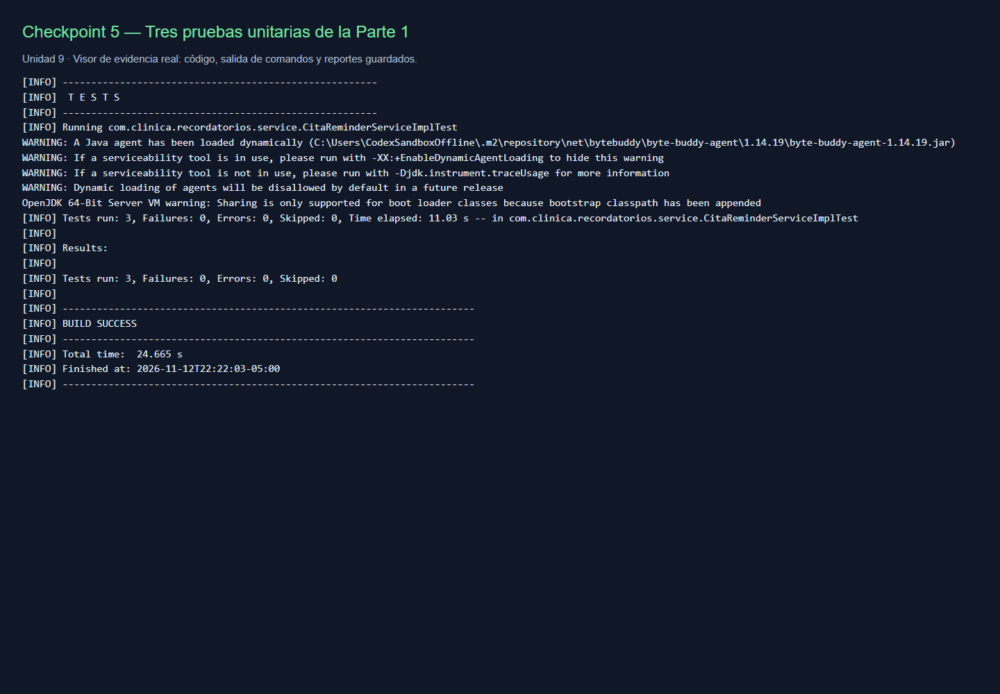
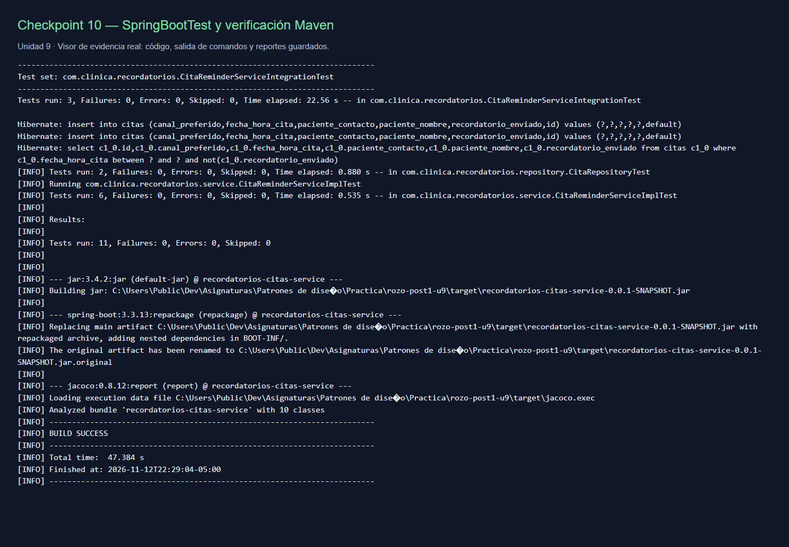
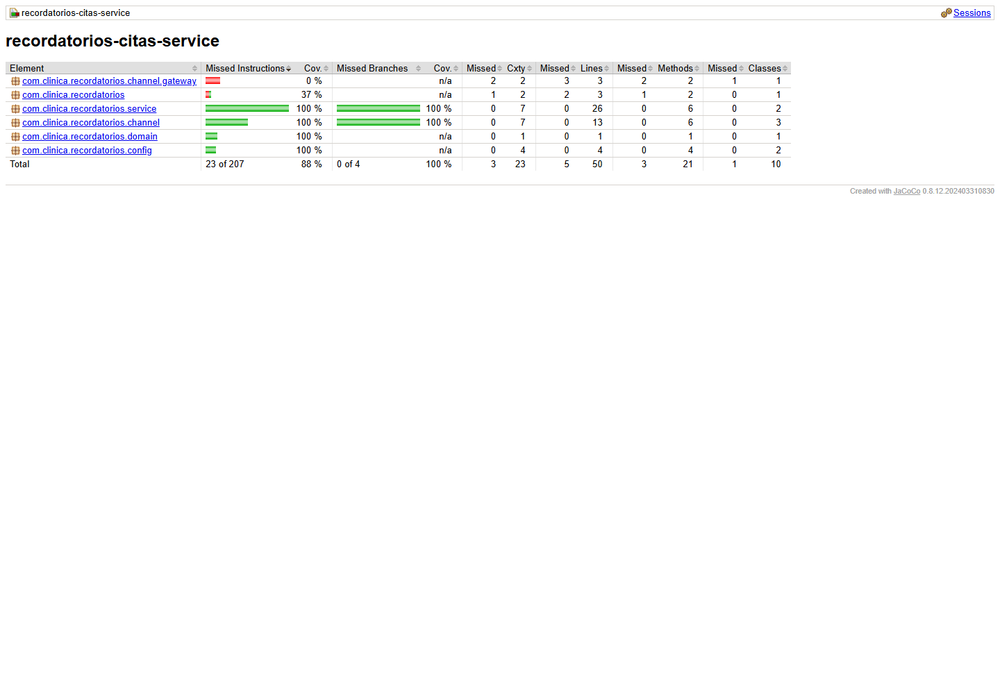
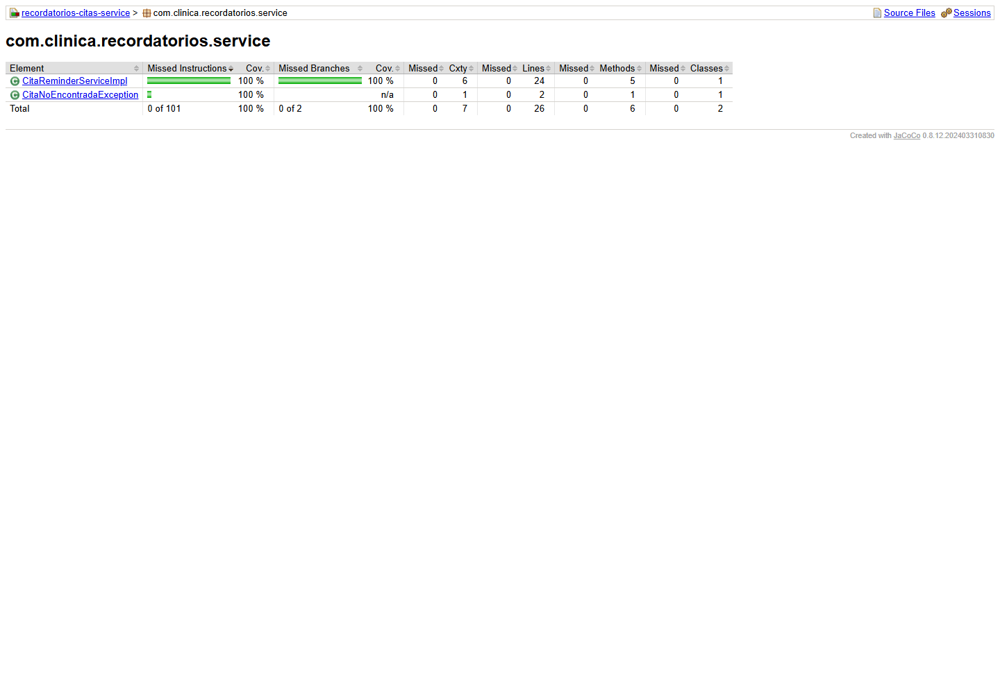

# Recordatorios Citas Service


## Descripción

Post-contenido de la Unidad 9 de Patrones de Diseño de Software — Sexto Semestre.
Un único proyecto Maven contiene las dos partes: recordatorios por el canal preferido del paciente,
pruebas unitarias, refactor DIP, integración con H2 y CI. El servicio nace con Strategy
(`ReminderChannel`) y la Factory solicitada (`ReminderChannelFactory`) inyectados por constructor.

**Autor:** Jhoseth Esneider Rozo Carrillo.

## Requisitos y ejecución

JDK 21, `JAVA_HOME` apuntando a ese JDK y Maven 3.9+. Se incluye Maven Wrapper 3.9.14
obtenido de Spring Initializr. Desde la raíz:

```bash
mvn compile
mvn spring-boot:run
mvn test
mvn verify
```

Detener la aplicación con `Ctrl+C`. También se puede usar `./mvnw` en Linux/macOS o
`.\mvnw.cmd` en PowerShell en lugar de `mvn`. H2 arranca automáticamente en memoria;
la aplicación inicia con la base vacía en el puerto 8080, sin credenciales externas ni Docker.

`mvn test` ejecuta todas las clases terminadas en `Test`, incluidas las de integración.
`mvn verify` ejecuta esas pruebas, empaqueta el JAR y genera el reporte JaCoCo.
Para ejecutar solo las seis pruebas unitarias del servicio:

```bash
mvn -Dtest=CitaReminderServiceImplTest test
```

Si el directorio temporal de Windows contiene `&`, Surefire puede fallar al iniciar Java.
En ese entorno, usar una carpeta temporal dentro del proyecto:

```powershell
New-Item -ItemType Directory -Force .tmp | Out-Null
$env:TEMP = Join-Path (Get-Location) '.tmp'
$env:TMP = $env:TEMP
mvn verify
```

## Estructura

```text
.
├── pom.xml
├── mvnw / mvnw.cmd
├── .mvn/wrapper/maven-wrapper.properties
├── .github/workflows/ci.yml
├── src/main/java/com/clinica/recordatorios/
│   ├── RecordatoriosCitasServiceApplication.java
│   ├── domain/
│   │   ├── Cita.java
│   │   └── CanalNotificacion.java
│   ├── repository/CitaRepository.java
│   ├── channel/
│   │   ├── ReminderChannel.java
│   │   ├── EmailReminderChannel.java
│   │   ├── SmsReminderChannel.java
│   │   ├── ReminderChannelFactory.java
│   │   ├── ReminderChannelFactoryImpl.java
│   │   └── gateway/
│   │       ├── NotificadorSmsGateway.java
│   │       └── TwilioNotificadorSmsGateway.java
│   ├── service/
│   │   ├── CitaReminderService.java
│   │   ├── CitaReminderServiceImpl.java
│   │   └── CitaNoEncontradaException.java
│   └── config/
│       ├── ClockConfig.java
│       └── CanalUrgenteConfig.java
├── src/test/java/com/clinica/recordatorios/
│   ├── service/CitaReminderServiceImplTest.java
│   ├── repository/CitaRepositoryTest.java
│   └── CitaReminderServiceIntegrationTest.java
├── docs/CHECKPOINTS.md
├── docs/evidencias/
└── scripts/capturar_evidencias.py
```

## Parte 1 — Pruebas unitarias con JUnit 5 y Mockito

`CitaReminderServiceImplTest` usa `@ExtendWith(MockitoExtension.class)` sin arrancar Spring.
Verifica selección de EMAIL, mensaje y guardado, ventana exacta de 24 horas mediante
`ArgumentCaptor` y ausencia de llamadas a la Factory cuando no hay pendientes.
Las decisiones se registraron [antes de escribir las pruebas](https://github.com/JhosethRozo/rozo-post1-u9/commit/0a67ad0123f7b6d844c8c5e57422a2e65ef1e254).

## Parte 2 — Refactor DIP, integración y CI/CD

El historial conserva la [versión urgente con dependencias hardcodeadas y el diagnóstico](https://github.com/JhosethRozo/rozo-post1-u9/commit/8ceef3f56362f08f7e9f0dd27553d21aa2ca0cf6),
seguida del refactor y de las pruebas habilitadas por la inyección. Las tres pruebas urgentes
cubren éxito, fallo del gateway y cita inexistente. El fallo comprueba explícitamente que la cita
permanece sin marcar, la excepción se propaga y no se llama a `save`.

`CitaRepositoryTest` usa `@DataJpaTest` con H2: el escenario solicitado de tres citas devuelve
exactamente una pendiente en la ventana. Otra prueba comprueba los límites inclusivos de `Between`.

`CitaReminderServiceIntegrationTest` usa `@SpringBootTest`, Factory y estrategias reales,
JPA/H2 reales, un reloj fijo `@Primary` y `@MockBean NotificadorSmsGateway`. Comprueba SMS,
EMAIL, persistencia, ausencia de reenvío y estado pendiente en base de datos cuando falla el envío urgente.
El bean de prueba se llama `clockFijo` para evitar colisionar con `ClockConfig.clock`;
`@Primary` selecciona el reloj fijo sin habilitar sobrescritura de beans.

## Decisiones de diseño

### Mock, Stub o Fake para cada colaborador

| Colaborador | Elección | Justificación y comprobación |
| --- | --- | --- |
| `CitaRepository` | Mock | Se controla la consulta mediante stubbing y se verifica `save` exactamente una vez con la cita ya marcada. Un stub solo devolvería respuestas. |
| `ReminderChannelFactory` | Mock | Se prepara su retorno y se verifica `obtenerCanal(EMAIL)`: interesa qué estrategia solicita el servicio. |
| `ReminderChannel` devuelto | Mock | Se verifica `enviar` con la cita y el mensaje exactos sin depender de SMTP o SMS. |
| `Clock` | Fake con `Clock.fixed` | Implementación completa del JDK que congela el instante y mantiene el funcionamiento real de `LocalDateTime.now(clock)`. No se mockean `instant` ni `getZone`. |
| `canalUrgente`, Parte 2 | Mock | Permite simular una excepción y verificar que no se guarda ni marca la cita cuando falla el envío. |

`Clock.fixed` se clasifica como fake según la terminología del laboratorio; técnicamente es una
implementación real del JDK. Configurar respuestas con Mockito es stubbing, pero el doble actúa
como mock cuando también verificamos interacciones.

### Mapeo patrón → prueba

| Patrón o principio | Prueba facilitada | Dificultad sin él |
| --- | --- | --- |
| Strategy, `ReminderChannel` | `enviarRecordatoriosPendientes_citaEnVentana_usaElCanalPreferido` verifica el envío mediante una interfaz propia. | Con el transporte dentro del servicio habría que interceptar clientes SMTP/HTTP o sus efectos. Una interfaz permite sustituir cualquier canal. |
| Factory, `ReminderChannelFactory` | La misma prueba verifica `obtenerCanal(EMAIL)`; la integración ejecuta el selector real con EMAIL y SMS. | Un selector embebido no expondría una interacción de Factory; sería necesario observar sus efectos sobre transportes concretos. |
| DIP y composition root | `enviarRecordatorioUrgente_gatewayFalla_noMarcaComoEnviado`. | El `new` interno impide sustituir el canal mediante el constructor. Tras el refactor, `doThrow` controla el fallo sobre el canal inyectado. |
| Inyección de `Clock` | `enviarRecordatoriosPendientes_ventanaDeterministaSegunClockFijo_consultaLosLimitesExactos`. | El reloj del sistema cambia. El fijo reproduce exactamente 2026-08-10 09:00 UTC → 2026-08-11 09:00 UTC. |

Se conserva la Factory con interfaz y `switch` pedida por la guía, donde se denomina Factory Method.
En sentido estricto es una fábrica de selección inyectable; no implementa la jerarquía de creadores
y sobrescritura del Factory Method clásico de GoF.

### Diagnóstico antes del refactor DIP

La línea responsable dentro de `enviarRecordatorioUrgente` era:

```java
ReminderChannel canalUrgente = new SmsReminderChannel(new TwilioNotificadorSmsGateway());
```

El método usaba esas instancias aunque la prueba preparara otros objetos. Por ello no permitía
simular el fallo mediante Mockito convencional e inyección. En contraste,
`enviarRecordatoriosPendientes` ya recibía sus colaboradores por constructor.
`mockConstruction` permitiría interceptar el `new`, pero acoplaría la prueba a la construcción
concreta; DIP resuelve la causa del problema de aislamiento.

Después, la construcción vive en `config/CanalUrgenteConfig.java`:

```java
@Bean
public ReminderChannel canalUrgente(NotificadorSmsGateway gateway) {
    return new SmsReminderChannel(gateway);
}
```

El servicio recibe `@Qualifier("canalUrgente") ReminderChannel canalUrgente` por constructor
y solo llama `canalUrgente.enviar(...)` antes de marcar y guardar. Conserva el comportamiento externo.
El `new CitaNoEncontradaException` permanece porque construye una excepción del dominio,
no un colaborador de infraestructura. Hay exactamente dos clases que implementan `ReminderChannel`;
el bean urgente es otra instancia de `SmsReminderChannel`, no una tercera implementación.

### Por qué H2 real y gateway mockeado

H2 ejecuta de verdad el mapeo JPA, las consultas y la persistencia; sustituye la infraestructura
de producción en este laboratorio sin un servidor externo. No es completamente equivalente a
PostgreSQL u otro motor: estas pruebas no demuestran compatibilidad de todos sus dialectos.
Un proveedor SMS depende de red, credenciales y disponibilidad; el mock permite controlar
fallos y llamadas de forma determinista. El gateway Twilio del ejercicio simula el transporte
por consola, sin invocar una API real.

### CI sin contenedor de base de datos

`.github/workflows/ci.yml` ejecuta `mvn -B verify --no-transfer-progress` en push a `main`
y pull request hacia `main`, con Temurin 21 y caché Maven. No hay `services:` porque H2 vive
dentro del proceso. PostgreSQL con Testcontainers requeriría Docker y el arranque del contenedor.
El workflow conserva JaCoCo y Surefire en el artefacto `pruebas-y-cobertura`.
Se implementa integración continua; no se solicita un despliegue a producción.

## Verificación y evidencias

`mvn clean verify` pasa **11 pruebas: 6 unitarias, 2 de repositorio y 3 del contexto completo**,
sin fallos, errores ni omitidas. El servicio tiene **100 % de cobertura de instrucciones y ramas**.
El reporte general muestra también el código no ejecutado, incluido el transporte SMS simulado
y el método `main`. No se impone un umbral de cobertura que la guía no exige.






El [índice de checkpoints](docs/CHECKPOINTS.md) relaciona cada requisito con capturas y logs.
Las capturas de comandos muestran un visor HTML de salidas reales guardadas; las de cobertura
muestran directamente el HTML de JaCoCo. No son capturas de un IDE ni resultados simulados.
El script de captura requiere Python y Playwright, independientemente del build Maven.
El reporte navegable se genera en `target/site/jacoco/index.html` y los resultados en
`target/surefire-reports/`.

## Alcance del enunciado

Se conserva el comportamiento del código solicitado: EMAIL imprime en consola y SMS usa un
gateway simulado. No se añaden endpoints ni un scheduler que la guía no implementa; el servicio
consulta pendientes cuando se invoca. Aunque la descripción menciona dos horas para urgentes,
el método proporcionado envía por ID sin validar ventana, confirmación ni envío previo;
se respeta ese contrato. El modelo no incluye un campo de confirmación.

## Herramientas utilizadas

Java 21, Spring Boot 3.3.13, Spring Web, Spring Data JPA, H2, Lombok, JUnit 5,
Mockito, Maven 3.9.14, JaCoCo 0.8.12, Git y GitHub Actions.

## Conclusiones

Strategy permite comprobar el envío mediante una interfaz estable y Factory hace observable
la selección del canal. El doble se elige según lo que se necesita comprobar: interacción con
mocks y tiempo determinista con el fake `Clock.fixed`. El refactor DIP habilitó la prueba de
fallo urgente al mover la construcción a Spring. Las pruebas con H2 y el pipeline completan
la verificación con persistencia real y ejecuciones reproducibles.

## Entrega

Subir a la plataforma del curso: **https://github.com/JhosethRozo/rozo-post1-u9**.
